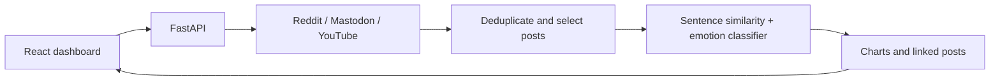

# Multi-Source Social Media Mood Analyzer

Explore emotions in topic-related posts from Reddit, Mastodon, and YouTube using a FastAPI API and React 19 dashboard. This is an exploratory sample of retrieved posts, not a representative measure of public opinion.



## Structure

```text
backend/
  app/main.py          API, source collectors and analysis
  tests/               Offline API and regression checks
  pyproject.toml       Python 3.11 dependencies and dev tools
  uv.lock              Locked CPU inference dependencies
  Dockerfile
frontend/
  src/                 React components and shared API client
  Dockerfile           Vite build + Nginx API proxy
  nginx.conf
.github/workflows/ci.yml
Makefile
docker-compose.yml
render.yaml
docs/deployment.md
docs/core-feature-review.md
```

## Local development

Requires Python 3.11, [uv](https://docs.astral.sh/uv/), Node.js 22+, and npm.

```bash
make setup
# Edit backend/.env: configure at least one social source.
make backend-install frontend-install
make backend-dev
# In another terminal:
make frontend-dev
```

Open `http://localhost:5173`. Vite proxies `/api` to the backend on port 8000. API documentation is at `http://localhost:8000/docs`.

## Docker

```bash
make setup
# Add source credentials to backend/.env.
make docker-up
make docker-logs
make docker-down
```

Open `http://localhost:8080`. Nginx proxies `/api` to the backend container. A named volume retains downloaded model files. CPU-only dependencies and one API worker avoid duplicate model copies. The first analysis downloads two models and takes longer.

## Configuration

Copy the supplied `.env.example` files with `make setup`. Reddit requires a client ID and secret; Mastodon requires a token and instance URL; YouTube requires an API key. Sources without credentials are skipped. `/analyze` returns 503 if none are configured. Actual source access and successful analysis still require live verification with valid credentials.

`VITE_API_URL` is public build-time configuration: use `/api` locally and the backend's HTTPS URL for static hosting. `CORS_ORIGINS` is a comma-separated allowlist of frontend origins. No API secrets belong in the frontend.

## API

| Method | Route | Purpose |
| --- | --- | --- |
| GET | `/health` | Process liveness, configured sources, model-load state |
| GET | `/trending` | Suggested short titles from configured Reddit/YouTube sources |
| POST | `/analyze` | Analyze `{"topic":"climate","limit":20}` |

`limit` controls the per-source displayed lists, not collection cost. Analysis considers at most 200 deduplicated posts. The current classifier is English-only. `/health` success does not prove model inference or external source access.

## Checks and deployment

```bash
make check
```

CI runs offline backend tests, Python correctness lint, frontend lint, a production build and both Docker image builds. See [deployment instructions](docs/deployment.md) for Render configuration, [model and source options](docs/model-and-source-options.md) for researched local models and public fetchers, and [the core feature review](docs/core-feature-review.md) for prioritized product changes. See [local validation results](docs/validation.md) for checks completed and remaining verification.

Created by [Taha Chelly](https://tahachelly.com/).
